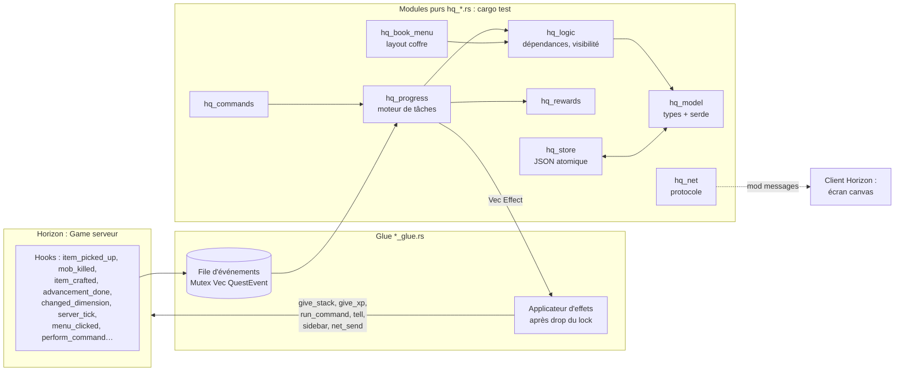

# Architecture de Horizon Quest

> [!abstract] Résumé
> Un seul bundle natif, en deux moitiés :
> - **Serveur autoritaire** : il détient les définitions, la progression et les récompenses. Il marche seul avec des clients vanilla grâce aux **menus coffre**, au chat et à la sidebar.
> - **Client Horizon (optionnel)** : un vrai **livre de quêtes graphique** (canvas pannable), alimenté par les *mod messages*.
>
> La logique est entièrement dans des **modules purs testables**, et une fine couche de *glue* parle au jeu. C'est le pattern de [[Exemple - mod smp (patterns à reprendre)|smp]].

Décisions liées : [[ADR-002 Serveur autoritaire et double interface]] · [[ADR-003 Hook points plutôt qu'injections brutes]] · [[ADR-004 Style bundle mixin comme smp]]

## Vue d'ensemble


## Principe « événements → règles → effets »
1. Les **hooks** (glue) ne font **presque rien** : ils traduisent l'événement du jeu en `QuestEvent` et le poussent dans une file. Ils ne prennent jamais le lock principal en bloquant (`try_lock` ou une file séparée), pour éviter la ré-entrance.
2. Au **`native_server_tick`** (phase `End`), on vide la file. Le moteur pur `hq_progress::apply(state, event) -> Vec<Effect>` met à jour la progression.
3. Les **effets** (`Effect::Give(uuid, stack)`, `GiveXp`, `RunCommand`, `Tell`, `Toast`, `SyncToClient`, `Sidebar`…) sont appliqués **après avoir relâché le lock**. `native_run_command` n'est autorisé que hors joueur injecté, d'où le passage par le tick.
4. Le **sondage** (inventaire pour les tâches item tant que `player_inventory_changed` est ⏳, position, biome) tourne au tick avec un pas configurable (20 ticks par défaut, comme `detection_delay` chez FTB).
5. La **sauvegarde** se fait en fin de tick si `dirty`, avec un flush à la fermeture du monde (`native_world_lifecycle`) et à la déconnexion.

## Modules (prévus)
| Module | Rôle | Pur ? |
|---|---|---|
| `hq_model` | Types : `QuestFile`, `Chapter`, `Quest`, `Task`, `Reward`, `RewardTable`, `TeamProgress`… + (dé)sérialisation serde | ✅ |
| `hq_logic` | Graphe de dépendances, détection de cycles, visibilité, « startable », modes de progression | ✅ |
| `hq_progress` | Moteur : `QuestEvent` → progression des tâches → complétion → `Effect` | ✅ |
| `hq_rewards` | Tirages pondérés, choice, team vs joueur, auto-claim | ✅ (RNG injecté) |
| `hq_teams` | Équipes minimales : perso, party, fusion et copie de progression | ✅ |
| `hq_commands` | Parsing `/quests …` → `Vec<Out>` | ✅ |
| `hq_book_menu` | Livre en **menus coffre** : `layout() -> Vec<Cell>`, `click(slot) -> Click` | ✅ |
| `hq_net` | Messages client ↔ serveur (versionnés, < 30 000 octets, découpés) | ✅ |
| `hq_store` | Lecture et écriture JSON atomiques, migrations de version | ✅ (fs) |
| `hq_import_ftb` | Import JSON5/SNBT FTB → notre format (plus tard) | ✅ |
| `glue.rs` | État global `static STATE: Mutex<Option<Hq>>`, branchement des hooks, application des effets | ❌ |
| `client_glue.rs` | Écran de mod, rendu du canvas, entrées, toasts | ❌ |

## État et threads
- `static STATE: Mutex<Option<Hq>>`, initialisé paresseusement à partir de `native_world_dir()`. Rouvert si le monde change, avec des locks tolérants au poison.
- Une instance du mod sert **le jeu fenêtre et le jeu serveur** : il faut bien séparer l'état serveur de l'état client (deux statics distincts).
- Le client est mono-thread : `thread_local!` + `RefCell` pour l'état de l'écran.

## Arborescence cible du dépôt
```
Horizon_quest/
├── CLAUDE.md            ← instructions pour Claude (pointe vers le vault)
├── README.md
├── vault/               ← CE VAULT (Obsidian)
├── mod/                 ← le bundle natif
│   ├── Cargo.toml
│   ├── src/lib.rs
│   ├── compatibility.json
│   ├── LICENSE
│   └── mixins/horizon_quest/
│       ├── horizon-mixin.toml
│       ├── *.rs (helpers), *_glue.rs, hq_*.rs
│       └── data/        ← quêtes d'exemple embarquées
├── examples/quests/     ← packs de quêtes d'exemple
└── ext/                 ← clones de référence (gitignore) : horizon, horizon-mods
```
