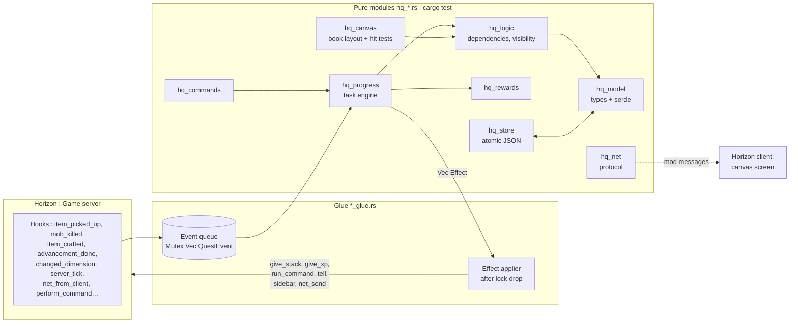

# Horizon Quests architecture

> [!abstract] Summary
> A single native bundle, in two halves:
> - **Authoritative server**: it holds the definitions, the progress and the rewards. In solo/LAN it runs in the integrated server.
> - **Horizon client**: the **graphical quest book** (pannable canvas), fed by *mod messages*. It ships in the MVP ([[ADR-008 Graphical client book first]]).
>
> All the logic lives in **pure, testable modules**, and a thin *glue* layer talks to the game. This is the pattern from [[Example - smp mod (patterns to reuse)|smp]].

Related decisions: [[ADR-002 Authoritative server and dual UI]] · [[ADR-008 Graphical client book first]] · [[ADR-003 Hook points over raw injections]] · [[ADR-004 Mixin bundle style like smp]]

## Overview


## The "events → rules → effects" principle
1. The **hooks** (glue) do **almost nothing**: they translate the game event into a `QuestEvent` and push it onto a queue. They never take the main lock in a blocking way (`try_lock` or a separate queue), to avoid re-entrancy.
2. On **`native_server_tick`** (`End` phase), the queue is drained. The pure engine `hq_progress::apply(state, event) -> Vec<Effect>` updates the progress.
3. The **effects** (`Effect::Give(uuid, stack)`, `GiveXp`, `RunCommand`, `Tell`, `Toast`, `SyncToClient`, `Sidebar`…) are applied **after releasing the lock**. `native_run_command` is only allowed outside an injected player, hence going through the tick.
4. **Polling** (inventory for item tasks while `player_inventory_changed` is ⏳, position, biome) runs on the tick with a configurable step (20 ticks by default, like `detection_delay` in FTB).
5. **Saving** happens at the end of the tick if `dirty`, with a flush on world close (`native_world_lifecycle`) and on disconnect.

## Modules (planned)
| Module | Role | Pure? |
|---|---|---|
| `hq_model` | Types: `QuestFile`, `Chapter`, `Quest`, `Task`, `Reward`, `RewardTable`, `TeamProgress`… + serde (de)serialization | ✅ |
| `hq_logic` | Dependency graph, cycle detection, visibility, "startable", progression modes | ✅ |
| `hq_progress` | Engine: `QuestEvent` → task progress → completion → `Effect` | ✅ |
| `hq_rewards` | Weighted draws, choice, team vs player, auto-claim | ✅ (injected RNG) |
| `hq_teams` | Minimal teams: personal, party, progress merge and copy | ✅ |
| `hq_commands` | Parsing `/quests …` → `Vec<Out>` | ✅ |
| `hq_canvas` | Graphical book maths: pan/zoom transform, quest and line layout, hit testing, homemade widget layout | ✅ |
| `hq_net` | Client ↔ server messages (versioned, < 30,000 bytes, chunked) | ✅ |
| `hq_store` | Atomic JSON reads and writes, version migrations | ✅ (fs) |
| `hq_import_ftb` | Import FTB JSON5/SNBT → our format (later) | ✅ |
| `glue.rs` | Global state `static STATE: Mutex<Option<Hq>>`, hook wiring, effect application | ❌ |
| `client_glue.rs` | Mod screen, canvas rendering, input, toasts | ❌ |

## State and threads
- `static STATE: Mutex<Option<Hq>>`, lazily initialized from `native_world_dir()`. Reopened if the world changes, with poison-tolerant locks.
- A single instance of the mod serves **both the windowed game and the server game**: the server state must be kept strictly separate from the client state (two distinct statics).
- The client is single-threaded: `thread_local!` + `RefCell` for the screen state.

## Target repository layout
```
Horizon_quest/
├── CLAUDE.md            ← instructions for Claude (points to the vault)
├── README.md
├── vault/               ← THIS VAULT (Obsidian)
├── mod/                 ← the native bundle
│   ├── Cargo.toml
│   ├── src/lib.rs
│   ├── compatibility.json
│   ├── LICENSE
│   └── mixins/horizon_quests/
│       ├── horizon-mixin.toml
│       ├── *.rs (helpers), *_glue.rs, hq_*.rs
│       └── data/        ← embedded example quests
├── examples/quests/     ← example quest packs
└── ext/                 ← reference clones (gitignored): horizon, horizon-mods
```
