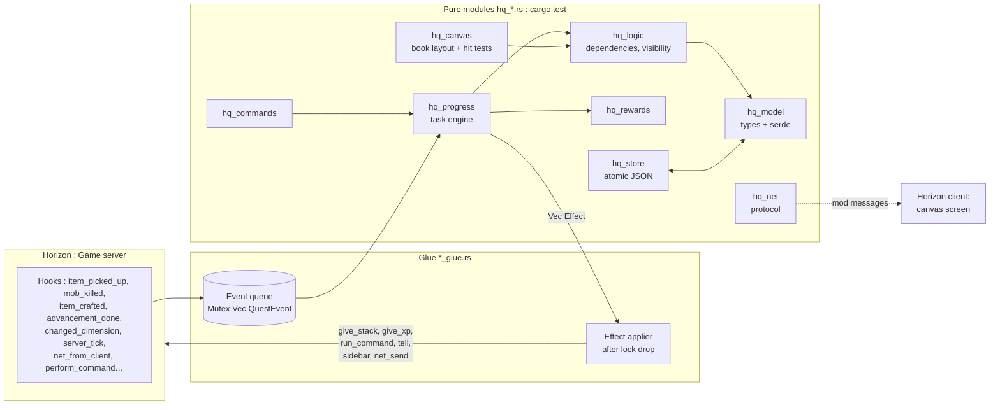

# Horizon Quests architecture

> [!abstract] Summary
> A single native bundle, in two halves:
> - **Authoritative server**: it holds the definitions, the progress and the rewards. In solo/LAN it runs in the integrated server.
> - **Horizon client**: the **graphical quest book** (pannable canvas), fed by *mod messages*. It ships in the MVP ([[ADR-008 Graphical client book first]]).
>
> All the logic lives in **pure, testable modules**, and a thin *glue* layer talks to the game. This is the pattern from [[Example - smp mod (patterns to reuse)|smp]].

Related decisions: [[ADR-002 Authoritative server and dual UI]] · [[ADR-008 Graphical client book first]] · [[ADR-003 Hook points over raw injections]] · [[ADR-004 Mixin bundle style like smp]]

## Overview


## The "events → rules → effects" principle
1. The **hooks** (glue) do **almost nothing**: they translate the game event into a `QuestEvent` and push it onto a queue. They never take the main lock in a blocking way (`try_lock` or a separate queue), to avoid re-entrancy.
2. On **`native_server_tick`** (`End` phase), the queue is drained. The pure engine `hq_progress::apply(state, event) -> Vec<Effect>` updates the progress.
3. The **effects** (`Effect::Give(uuid, stack)`, `GiveXp`, `RunCommand`, `Tell`, `Toast`, `SyncToClient`, `Sidebar`…) are applied **after releasing the lock**. `native_run_command` is only allowed outside an injected player, hence going through the tick.
4. **Polling** (inventory for item tasks while `player_inventory_changed` is ⏳, position, biome) runs on the tick with a configurable step (20 ticks by default, like `detection_delay` in FTB).
5. **Saving** happens at the end of the tick if `dirty`, with a flush on world close (`native_world_lifecycle`) and on disconnect.

## Modules
Status on 2026-11-10: ✔ written and tested · ◻ planned.

> [!warning] A pure module joins the bundle with its glue
> The game is built with `-D warnings`, so a module nothing calls yet is dead code there and breaks the build. A new `hq_*.rs` is first listed in `mod/src/lib.rs` only (for `cargo test`); its `[[module]]` entry in `horizon-mixin.toml` is added in the same commit as the glue that uses it.

| Module | Role | Pure? |
|---|---|---|
| ✔ `hq_model` | Types: `Settings`, `Chapter`, `Quest`, `Task`, `Reward`, `QuestFile`, `Progress` + serde; id helpers (`quest_id`, `child_id`, `dependency_id`, `resource_id`) | ✅ |
| ✔ `hq_validate` | `load` / `load_dir`: read a pack, report every `Problem` with its place, leave bad chapters out; cycle detection; writes item and entity ids in full | ✅ (fs) |
| ✔ `hq_logic` | `Book`: the pack indexed, dependencies resolved, topological order; `dependencies_met`, `can_progress`, `statuses`, chapter tallies | ✅ |
| ✔ `hq_progress` | Engine: `apply(book, progress, player, now, event) -> Outcome { changed, effects }`; `wanted_items`, `submit_request`; claims and auto-claim | ✅ |
| ◻ `hq_rewards` | V1: weighted draws, choice, team vs player (the MVP's claims live in `hq_progress`) | ✅ (injected RNG) |
| ◻ `hq_teams` | V1. Minimal teams: personal, party, progress merge and copy | ✅ |
| ◻ `hq_commands` | Parsing `/quests …` → `Vec<Out>` | ✅ |
| ✔ `hq_canvas` | Graphical book maths: pan/zoom transform, hit testing, line quads (phase 0). ◻ Real quests from a `Book`, sidebar and detail panel layout | ✅ |
| ◻ `hq_net` | Client ↔ server messages (versioned, < 30,000 bytes, chunked). `hq_protocol` is its phase 0 spike (ping/pong) | ✅ |
| ✔ `hq_store` | Atomic JSON reads and writes, `progress/<team>.json`, version check, UUID names. ◻ Writer thread, `teams.json`, `audit.log` | ✅ (fs) |
| ◻ `hq_import_ftb` | Import FTB JSON5/SNBT → our format (later) | ✅ |
| ✔ `hq_server_glue.rs` (spike) | Server half. ◻ Global state `static STATE: Mutex<Option<Hq>>`, hook wiring, effect application | ❌ |
| ✔ `hq_client_glue.rs` (spike) | Mod screen, canvas rendering, input. ◻ The real book, toasts | ❌ |

## How the glue drives the engine (phase 2)
```
hook (kill, book request…)      → push QuestEvent on the queue
server tick, every detection_delay:
    for each online player       → wanted_items(book, progress)
                                    count them in the inventory → QuestEvent::ItemCount
server tick, End phase:
    drain the queue              → apply(book, &mut progress, player, now, &event)
    outcome.changed              → hq_store::save_progress, send progress to the book
    outcome.effects              → after the lock is released: give rewards, chat, sound
book "Submit" request            → submit_request(book, progress, task) → take ≤ missing items
                                    → QuestEvent::Submitted { task, count: taken }
login, /quests reload            → QuestEvent::Refresh
```

## State and threads
- `static STATE: Mutex<Option<Hq>>`, lazily initialized from `native_world_dir()`. Reopened if the world changes, with poison-tolerant locks.
- A single instance of the mod serves **both the windowed game and the server game**: the server state must be kept strictly separate from the client state (two distinct statics).
- The client is single-threaded: `thread_local!` + `RefCell` for the screen state.

## Target repository layout
```
Horizon_quest/
├── CLAUDE.md            ← instructions for Claude (points to the vault)
├── README.md
├── vault/               ← THIS VAULT (Obsidian)
├── mod/                 ← the native bundle
│   ├── Cargo.toml
│   ├── src/lib.rs
│   ├── compatibility.json
│   ├── LICENSE
│   └── mixins/horizon_quests/
│       ├── horizon-mixin.toml
│       ├── *.rs (helpers), *_glue.rs, hq_*.rs
│       └── data/        ← embedded example quests
├── examples/quests/     ← example quest packs
└── ext/                 ← reference clones (gitignored): horizon, horizon-mods
```
