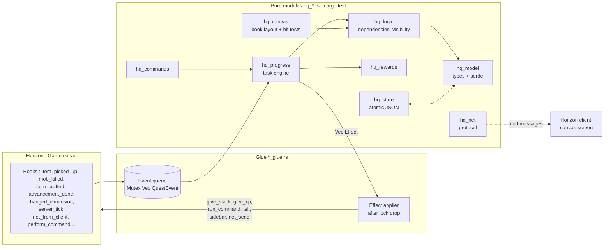

# Horizon Quests architecture

> [!abstract] Summary
> A single native bundle, in two halves:
> - **Authoritative server**: it holds the definitions, the progress and the rewards. In solo/LAN it runs in the integrated server.
> - **Horizon client**: the **graphical quest book** (pannable canvas), fed by *mod messages*. It ships in the MVP ([[ADR-008 Graphical client book first]]).
>
> All the logic lives in **pure, testable modules**, and a thin *glue* layer talks to the game. This is the pattern from [[Example - smp mod (patterns to reuse)|smp]].

Related decisions: [[ADR-002 Authoritative server and dual UI]] · [[ADR-008 Graphical client book first]] · [[ADR-003 Hook points over raw injections]] · [[ADR-004 Mixin bundle style like smp]]

## Overview


## The "events → rules → effects" principle
1. The **hooks** (glue) do **almost nothing**: they translate the game event into a `QuestEvent` and push it onto a queue. They never take the main lock in a blocking way (`try_lock` or a separate queue), to avoid re-entrancy.
2. On **`native_server_tick`** (`End` phase), the queue is drained. The pure engine `hq_progress::apply(state, event) -> Vec<Effect>` updates the progress.
3. The **effects** (`Effect::Give(uuid, stack)`, `GiveXp`, `RunCommand`, `Tell`, `Toast`, `SyncToClient`, `Sidebar`…) are applied **after releasing the lock**. `native_run_command` is only allowed outside an injected player, hence going through the tick.
4. **Polling** (inventory for item tasks while `player_inventory_changed` is ⏳, position, biome) runs on the tick with a configurable step (20 ticks by default, like `detection_delay` in FTB).
5. **Saving** happens at the end of the tick if `dirty`, with a flush on world close (`native_world_lifecycle`) and on disconnect.

## Modules
Status on 2026-11-10: ✔ written and tested · ◻ planned.

> [!warning] A pure module joins the bundle with its glue
> The game is built with `-D warnings` and its modules are private, so a module (or an item of one) nothing calls is dead code there and breaks the build, even when `cargo test` is clean (there the items are `pub` in a library). A new `hq_*.rs` is first listed in `mod/src/lib.rs` only; its `[[module]]` entry in `horizon-mixin.toml` is added in the same commit as the glue that uses it. When the glue stops calling something, remove it (v0.0.3 broke the build this way: [[2026-11-10]] § Session 9).

| Module | Role | Pure? |
|---|---|---|
| ✔ `hq_model` | Types: `Settings`, `Chapter`, `Quest`, `Task`, `Reward`, `QuestFile`, `Progress` + serde; id helpers (`quest_id`, `child_id`, `dependency_id`, `resource_id`) | ✅ |
| ✔ `hq_validate` | `load` / `load_pack` / `load_dir`, and since v0.4.0 `load_data` (the data packs' `data/<ns>/horizon_quests/` files as Horizon's reload listener hands them, every namespace one pack, the first `quests.json` as settings): read a pack (chapters and reward tables), report every `Problem` with its place, leave bad chapters and tables out; cycle detection; writes item, entity, dimension and advancement ids in full | ✅ (fs) |
| ✔ `hq_logic` | `Book`: the pack indexed, dependencies resolved, topological order; `dependencies_met`, `can_progress`, `task_counts` (tasks in order), `table`, `statuses`, chapter tallies | ✅ |
| ✔ `hq_progress` | Engine: `apply(book, progress, &Actor { player, now, roll }, event) -> Outcome { changed, effects }`; `wanted_items`, `wanted_crafts`, `watch`, `submit_request`; claims and auto-claim; reward tables (`draw`, `next_roll`); repeatable quests (`start_over`, [[ADR-011 Repeatable quests start over]]) | ✅ |
| ✘ `hq_rewards` | Not needed: weighted draws and choices went into `hq_progress` (v0.0.6). Claims stay per player inside a party (v0.2.0) | ✅ |
| ✔ `hq_teams` | v0.2.0, [[ADR-012 Parties share one progress]]. `Teams` (teams.json): parties with a name, an owner, members and invitations; a player in no party is their own team (id = their UUID string). `create`, `invite`, `can_join` / `join`, `leave`, `kick`, `member_named`, `saw`; `merge_progress` (joining) and `keep_claims` (leaving) | ✅ |
| ✔ `hq_commands` | `/quests`: `USAGES` to register, `parse` / `parse_for` (op level), `help`, `report` (validate, reload), `announce` (chat lines for effects) | ✅ |
| ✔ `hq_canvas` | Canvas maths: pan/zoom `View`, rect tests, grid cells, line quads (the spike's demo nodes and hit testing were removed in v0.0.4; `hq_book` hit-tests its own zones) | ✅ |
| ✔ `hq_book` | The real book: `BookView::scene(&Screen) -> Scene { draws, zones }` (draw list + click zones), regions, shapes, text wrapping, panel, buttons; `click` / `drag` / `scroll` → `Reaction`. HUD toasts: `Toasts` (queue, 5 s each, `set_stay` since v0.3.0), `toast_size`, `toast_draws` (v0.0.6). v0.5.0: the party's name in the header (`BookView.party`), a Track / Untrack button (`BookView.tracked`, `Reaction::Tracked`) and the tracked quest's HUD box (`tracked_size`, `tracked_draws`), item rows with an icon that open the recipe view (`Action::ShowRecipe` → `recipe_wanted`, the glue fills `RecipeOverlay { title, recipes: Vec<RecipeView>, page, clock }`, drawn over the book by `draw_recipe`), "(team)" rewards. v0.6.0: nodes drawn from the frame sheet `NODE_SPRITE` (`horizon_quests:gui/nodes`, cell from `node_cell(shape, state)`) as `Draw::Sprite { name, src, dst, fallback }`, the flat polygons as the fallback the glue paints when `native_sprite` has no such sprite | ✅ |
| ✔ `hq_net` | `ToServer` / `ToClient` (JSON, `PROTOCOL` 3 since v0.5.0: `Party { name }`; 2 since v0.0.6: `Claim { choice }`, `Toast`; channel `horizon_quests:book`), frames ≤ 30,000 bytes, `Sender` (16 frames a tick), `Receiver`. (The phase 0 spike `hq_protocol`, ping/pong, was removed in v0.0.4) | ✅ |
| ✔ `hq_store` | Atomic JSON reads and writes, `progress/<team>.json`, `teams.json` (`load_teams` / `save_teams`, v0.2.0), version check, UUID names. ◻ Writer thread, `audit.log` | ✅ (fs) |
| ◻ `hq_import_ftb` | Import FTB JSON5/SNBT → our format (later) | ✅ |
| ✔ `hq_session` | The server's state while a world is open: players, event queue, inventory look schedule, `dirty` (to save) and `unsynced` (to send) apart; `player_id(uuid)` is the id claims are kept under and the book looks them up under. v0.0.6: `crafted`, `set_level`, `advancement_done`, `observe` / `at` (place), `hand_in_plan` + `clear_command` (a guest's hand-in), `reward_command`, `toast` / `toast_line`. v0.2.0: progress **per team** (`teams` map of the teams with a member on, `progress(uuid)`, `team_of`, `team_loaded`), item counts and levels count the best member (`for_team`), quest / chapter effects told to every member on and their auto-claims woken, party commands (`team_info`, `create_team`, `invite`, `join_team`, `leave_team`, `kick`) with a `Load` closure for files of teams nobody plays on; `take_dirty` gives (team id, progress), `take_parties` | ✅ |
| ✔ `hq_config` | The config files (TOML, `toml` 1.1 from horizon-client); a wrong or unknown setting keeps its default and is logged. Server `horizon_quests-server.toml`: `DEFAULT_TEXT`, `parse(text) -> (ServerConfig, problems)`: `example_chapter`, `quest_book`, and since v0.3.0 `parties`, `party_size`, `detection_delay`, `completion_messages`. Client `horizon_quests-client.toml` (v0.3.0): `CLIENT_TEXT`, `parse_client` → `ClientConfig { toasts, toast_seconds }` | ✅ |
| ✔ `hq_server_glue.rs` | Server half: `static STATE: Mutex<Option<State>>`, hook wiring, effects after the lock, net senders/receivers per player, `Hello` answered once while its pack is in flight; crafts queued for the tick; book hand-ins: the host in place, a hub guest through `native_inventory` + `/clear` | ❌ |
| ✔ `hq_client_glue.rs` | Mod screen, the real book (`hq_book`) drawn and driven, net to the server, loading line with a 5 s "no answer" (`hq_book::loading_line`), state forgotten out of a world; toasts drawn on the HUD (top-right corner) | ❌ |

## How the glue drives the engine (phase 2)
```
hook (kill, book request…)      → push QuestEvent on the queue
server tick, every detection_delay:
    for each online player       → wanted_items(book, progress)
                                    count them in the inventory → QuestEvent::ItemCount
server tick, End phase:
    drain the queue              → apply(book, &mut progress, player, now, &event)
    outcome.changed              → hq_store::save_progress, send progress to the book
    outcome.effects              → after the lock is released: give rewards, chat, sound
book "Submit" request            → submit_request(book, progress, task) → take ≤ missing items (host: in place; guest: /clear)
                                    → QuestEvent::Submitted { task, count: taken }
login, /quests reload            → QuestEvent::Refresh
craft / furnace take             → queued (player, item, count); next tick: session.crafted → QuestEvent::Crafted per craft task
level change, advancement done   → session.set_level / advancement_done → QuestEvent::Level / Advancement
each look at a player            → session.observe: Level again if a task waits, Refresh if a quest waits to start over;
                                    when a task waits for a place: native_server_players() / native_player() → QuestEvent::At
```

## How the client glue drives the book (phase 2)
```
key K                            → native_mod_screen_open; view.open(&screen); Sender.send(Hello)
window tick                      → for frame in sender.tick(): native_net_send_to_server (put_back on error)
native_net_from_server           → receiver.push(frame) → ToClient:
                                     Book { file }      → Book::new(file); view.open(&screen)
                                     Progress { .. }    → keep it
                                     Notice { text }    → view.notice = text
                                     Toast { .. }       → toasts.push; native_hud draws the one on show
native_screen_render_post        → view.scene(&screen).draws → native_fill / native_quad / native_text / native_item_stack
mouse pressed / dragged / wheel  → view.click / drag / scroll(&screen)
                                     Reaction::Send(msg) → sender.send(&msg);  Reaction::Close → native_mod_screen_close
```
`Screen` = the book, the progress, the id the player's claims are kept under (`hq_session::player_id`, their UUID: sent in `ToClient::Progress`), the window rect, the pointer, and `&|text| game.native_text_width(text)`.
The server side mirrors it: one `Sender` and one `Receiver::new(SERVER_MAX_PARTS)` per player; `ToServer` → `hq_net::request_event` → the event queue (`Submit` goes through `submit_request` first).

## State and threads
- `static STATE: Mutex<Option<Hq>>`, lazily initialized from `native_world_dir()`. Reopened if the world changes, with poison-tolerant locks.
- A single instance of the mod serves **both the windowed game and the server game**: the server state must be kept strictly separate from the client state (two distinct statics).
- The client is single-threaded: `thread_local!` + `RefCell` for the screen state.

## Target repository layout
```
Horizon_quest/
├── CLAUDE.md            ← instructions for Claude (points to the vault)
├── README.md
├── vault/               ← THIS VAULT (Obsidian)
├── mod/                 ← the native bundle
│   ├── Cargo.toml
│   ├── src/lib.rs
│   ├── compatibility.json
│   ├── LICENSE
│   └── mixins/horizon_quests/
│       ├── horizon-mixin.toml
│       ├── *.rs (helpers), *_glue.rs, hq_*.rs
│       └── data/        ← embedded example quests
├── examples/quests/     ← example quest packs
└── ext/                 ← reference clones (gitignored): horizon, horizon-mods
```
